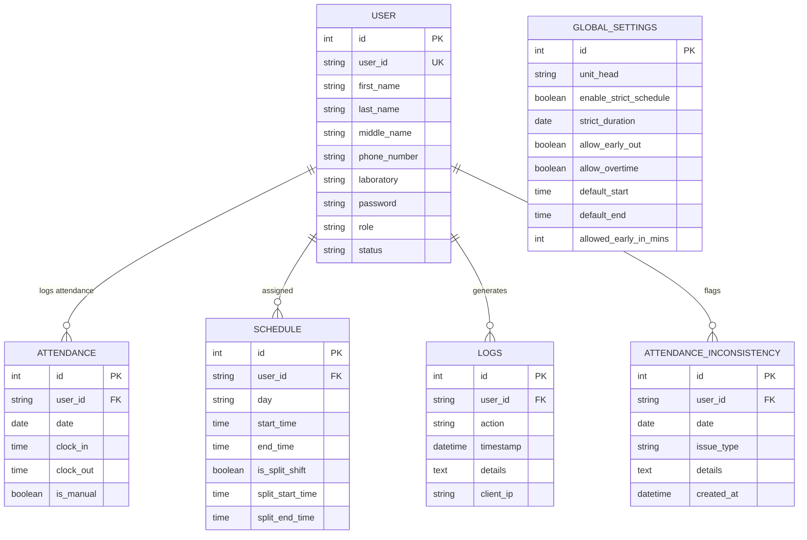

# Database Documentation

## Schema Overview

Tickr uses SQLAlchemy ORM supporting both SQLite and MySQL databases.

---

## Constraints & Indexes

1. **User Table:**
   - Primary key on `id`.
   - Unique, indexed constraint on `user_id`.
2. **Attendance Table:**
   - Composite index `idx_attendance_user_date` on `(user_id, date)` for rapid date range lookups.
   - Foreign key to `user.user_id` with `ON DELETE CASCADE`.
3. **Schedule Table:**
   - Unique constraint `unique_schedule_per_user_day` on `(user_id, day)` preventing duplicate shifts per block.
   - Day values: `mw`, `tth`, `fri`, `sat`.
4. **Logs Table:**
   - Foreign key to `user.user_id` with `ON DELETE SET NULL`.
   - Index on `timestamp` for descending audit log pagination.
5. **Alembic Migrations:**
   - Linear migration chain managed through Flask-Migrate:
     - `bfbe947c2750`: Initial schema.
     - `c7ca0d8dc6dd`: Added phone number and laboratory to user.
